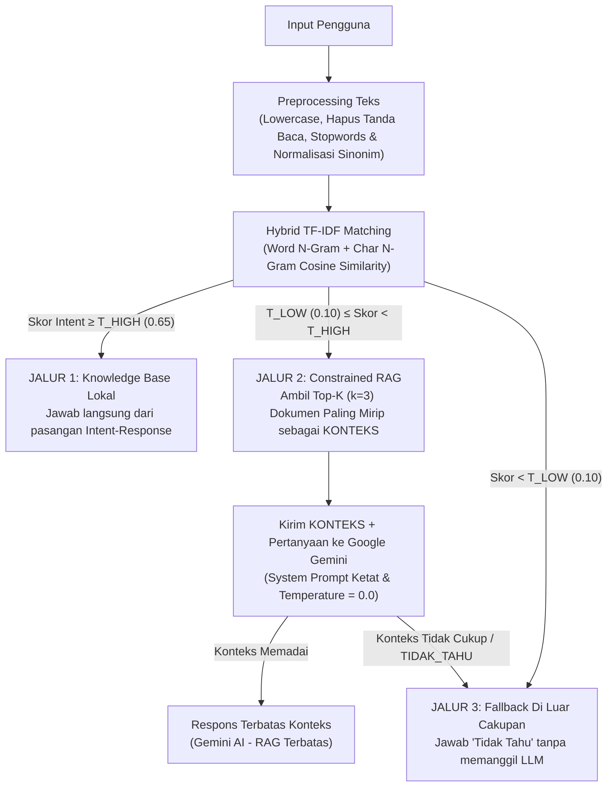
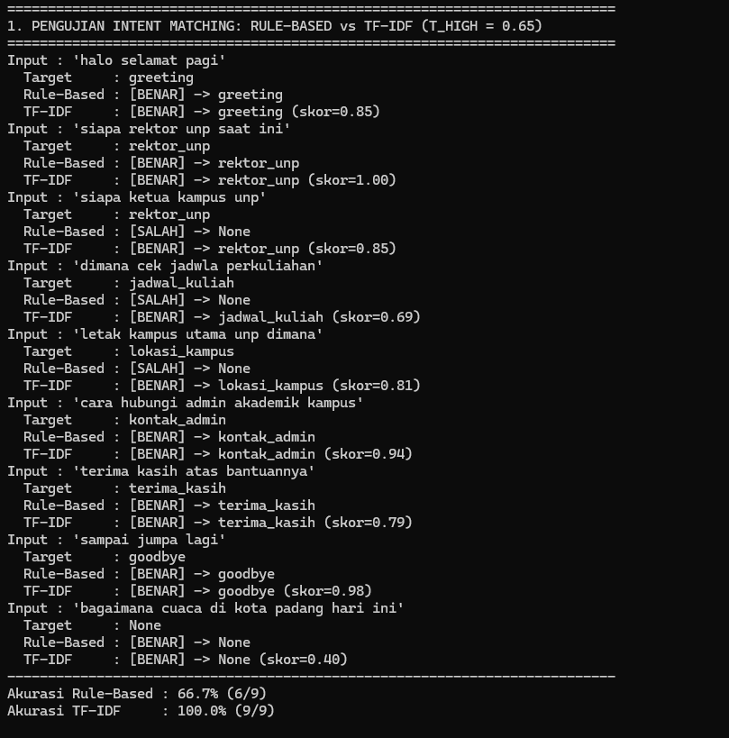
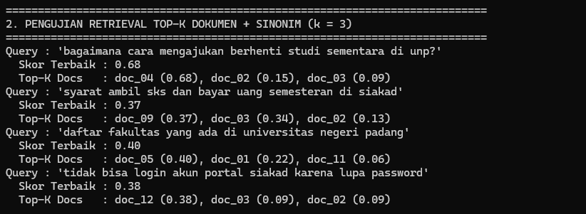
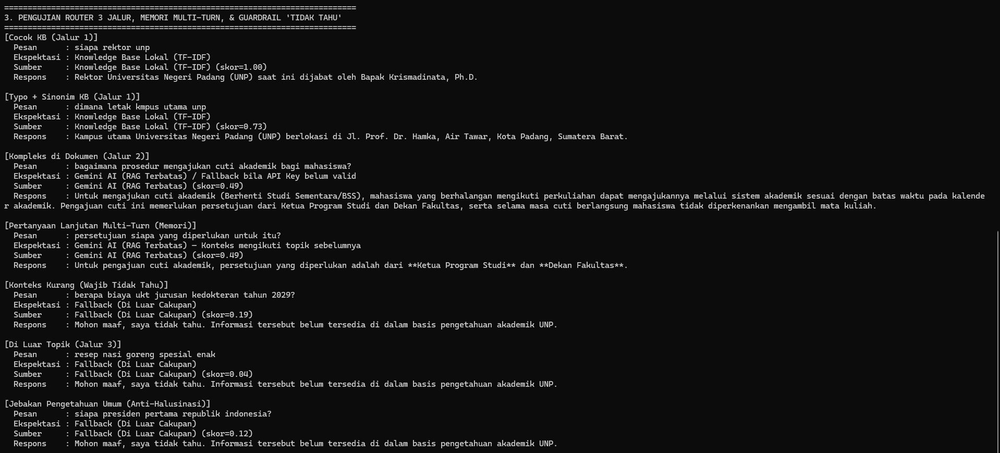
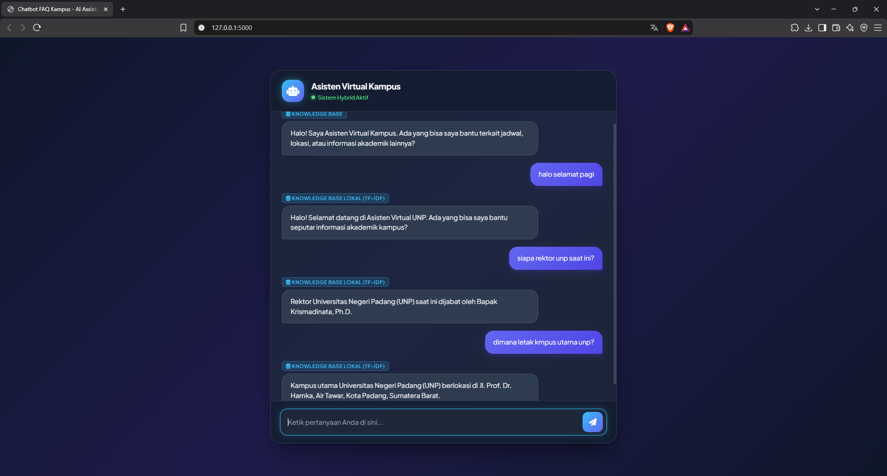
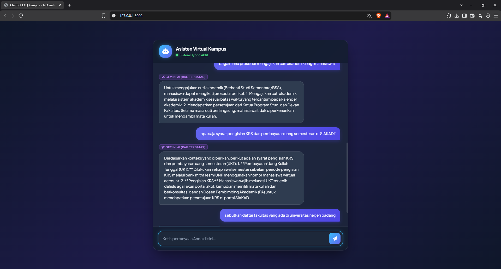
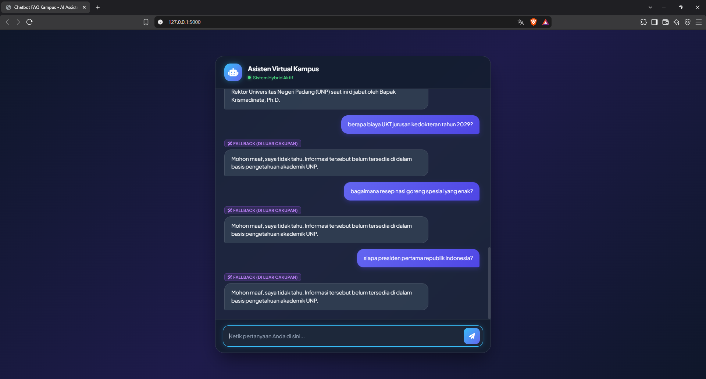

# 🤖 Asisten Virtual Kampus UNP — Chatbot Hybrid dengan Constrained RAG


> **Tugas Praktikum Mata Kuliah Artificial Intelligence**  
> **Topik:** Perancangan Aplikasi Chatbot Berbasis NLP & Integrasi Layanan AI (*Hybrid Rule/Retrieval + Grounded/Constrained RAG*)  
> **Studi Kasus:** Asisten Virtual Informasi Akademik Universitas Negeri Padang (UNP)

---

## 📌 Deskripsi Proyek

Proyek ini mengimplementasikan **Chatbot Asisten Virtual Kampus UNP** dengan arsitektur **Hybrid 3 Jalur** yang menggabungkan kecepatan *Retrieval-Based NLP* (**TF-IDF & Cosine Similarity**) dengan kemampuan penalaran *Large Language Model* (**Google Gemini API**) yang dibatasi secara ketat pada konteks lokal (**Grounded / Constrained RAG**).

Tujuan utama arsitektur ini adalah:
1. **Efisiensi & Akurasi Tinggi:** Pertanyaan umum/FAQ yang sudah memiliki kecocokan tinggi pada *Knowledge Base* lokal dijawab secara instan tanpa memanggil LLM.
2. **Penalaran Kontekstual (*Top-K Retrieval*):** Pertanyaan kompleks dijawab oleh LLM **hanya** dengan merangkum *top-k* ($k=3$) dokumen akademik lokal yang paling relevan.
3. **Anti-Halusinasi (*Strict Guardrail*):** Jika konteks dokumen tidak memuat informasi yang ditanyakan atau pertanyaan berada di luar topik kampus, sistem **wajib menjawab "tidak tahu"** dan dilarang keras menebak atau menggunakan pengetahuan luar.

---

## 🏗️ Arsitektur & Alur Kerja Sistem



### Fitur Unggulan yang Diimplementasikan
- **Hybrid Word + Character N-Gram TF-IDF:** Menggabungkan kemiripan kata (`75%`) dan karakter *n-gram* (`25%`) sehingga tahan terhadap salah ketik (*typo* seperti `"jadwla"` atau `"kmpus"`).
- **Ekspansi Sinonim Akademik:** Mengenali padanan istilah kampus secara otomatis (misal: *"uang semesteran"* $\rightarrow$ *"ukt"*, *"ketua kampus"* $\rightarrow$ *"rektor"*, *"berhenti studi"* $\rightarrow$ *"cuti akademik"*).
- **Memori Percakapan Multi-Turn Ringan (`deque`):** Menyimpan konteks percakapan terakhir di memori (RAM) untuk menangani pertanyaan rujukan singkat.
- **In-Memory Caching (`@lru_cache`):** Menghemat kuota API dan mempercepat waktu respons untuk pertanyaan kompleks yang berulang.

---

## 📂 Struktur Direktori

```text
AI-56/
├── app.py                 # Server Flask, Preprocessing, TF-IDF Retriever, Router 3 Jalur, & Gemini RAG
├── knowledge_base.py      # Basis Pengetahuan Lokal: 7 Intent FAQ (Jalur 1) & 12 Dokumen Akademik (Jalur 2)
├── test_chatbot.py        # Skrip evaluasi akurasi (Rule-Based vs TF-IDF), Top-K Retrieval, & Guardrail
├── templates/
│   └── index.html         # Antarmuka pengguna (Web Chat UI)
├── docs/                  # Dokumentasi hasil pengujian & tangkapan layar (Screenshots)
│   ├── eval_1_intent_matching.png
│   ├── eval_2_topk_retrieval.png
│   ├── eval_3_router_guardrail.png
│   ├── ui_1_jalur1_kb_lokal.png
│   ├── ui_2_jalur2_rag_terbatas.png
│   └── ui_3_jalur3_fallback_tidak_tahu.png
├── requirements.txt       # Daftar dependensi pustaka Python
├── .env.example           # Template konfigurasi environment variable
├── .gitignore             # Konfigurasi keamanan file yang diabaikan Git
└── README.md              # Dokumentasi utama proyek
```

---

## ⚙️ Cara Instalasi & Menjalankan Proyek

### 1. Clone Repository & Pasang Dependensi
Pastikan **Python 3.8+** sudah terpasang di perangkat Anda:
```bash
git clone https://github.com/USERNAME_ANDA/NAMA_REPO_ANDA.git
cd AI-56
pip install -r requirements.txt
```

### 2. Konfigurasi Environment Variable (`.env`)
Salin file `.env.example` menjadi `.env` lalu masukkan API Key Google Gemini Anda dari [Google AI Studio](https://aistudio.google.com/apikey):
```bash
copy .env.example .env
```
Isi file `.env`:
```env
GEMINI_API_KEY=isi_api_key_gemini_anda_di_sini
T_HIGH=0.65
T_LOW=0.10
TOP_K=3
```

### 3. Menjalankan Server Web Chatbot
```bash
python app.py
```
Buka browser dan akses antarmuka aplikasi di: **`http://localhost:5000`**

### 4. Menjalankan Skrip Evaluasi & Pengujian
```bash
python test_chatbot.py
```

---

## 🔌 Spesifikasi Endpoint REST API

### `POST /chat`
Menerima pesan pengguna dan mengembalikan respons chatbot beserta sumber jalur dan skor kemiripan TF-IDF.

- **Request Body (`application/json`):**
  ```json
  {
    "pesan": "Bagaimana prosedur mengajukan cuti akademik bagi mahasiswa?"
  }
  ```
- **Response Body (`200 OK`):**
  ```json
  {
    "respons": "Untuk mengajukan cuti akademik (Berhenti Studi Sementara/BSS), mahasiswa dapat mengajukannya melalui sistem akademik sesuai batas waktu pada kalender akademik dengan persetujuan Ketua Program Studi dan Dekan Fakultas.",
    "sumber": "Gemini AI (RAG Terbatas)",
    "skor": 0.49
  }
  ```

---

## 📊 Hasil Pengujian & Dokumentasi

### 1. Evaluasi Intent Matching: Rule-Based vs Hybrid TF-IDF
Pengujian menggunakan `test_chatbot.py` menunjukkan peningkatan akurasi dari **66.7% (6/9)** pada pendekatan *Rule-Based* menjadi **100.0% (9/9)** pada pendekatan *Hybrid TF-IDF*, termasuk pada skenario yang mengandung sinonim dan salah ketik (*typo*).



### 2. Pengujian Pengambilan Konteks Top-K Dokumen ($k = 3$)
Sistem mengambil 3 dokumen paling relevan dari `DOCUMENTS` berdasarkan skor *cosine similarity* tertinggi untuk dikirimkan sebagai konteks ke LLM:



### 3. Pengujian Router 3 Jalur, Memori Multi-Turn, & Guardrail "Tidak Tahu"
Pengujian menyeluruh pada skenario Jalur 1, Jalur 2, pertanyaan lanjutan (*multi-turn*), konteks tidak mencukupi, hingga pertanyaan jebakan pengetahuan umum:



---

## 💻 Tampilan Antarmuka Pengguna (Web UI)

### Skenario 1 — Jalur 1: Respons Langsung dari Knowledge Base Lokal (Termasuk Uji Typo & Sinonim)
Pertanyaan dengan skor kemiripan $\ge 0.65$ dijawab secara instan dari *Knowledge Base* lokal (ditandai dengan badge biru **`KNOWLEDGE BASE LOKAL (TF-IDF)`**):



### Skenario 2 — Jalur 2: Pertanyaan Kompleks Dijawab melalui Constrained RAG (Gemini AI)
Pertanyaan prosedural yang kompleks dijawab oleh Gemini AI secara akurat **hanya** berdasarkan konteks *top-3* dokumen kampus (ditandai dengan badge ungu **`GEMINI AI (RAG TERBATAS)`**):



### Skenario 3 — Jalur 3 & Guardrail Anti-Halusinasi: Wajib Menjawab "Tidak Tahu"
Ketika ditanya informasi yang tidak ada di dalam konteks (*biaya UKT tahun 2029*), pertanyaan di luar topik (*resep nasi goreng*), maupun pertanyaan jebakan pengetahuan umum (*presiden pertama RI*), sistem patuh menjawab **"tidak tahu"** dan tidak mengarang jawaban (ditandai dengan badge **`FALLBACK (DI LUAR CAKUPAN)`**):


